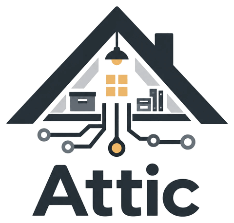

<h1 align="center">
  
</h1>

A personal, self-hosted record of the places its User lives and everything in them: repairs and improvements with receipts, vendors, maintenance schedules, appliance models and part numbers, paint colors, and a catalog of belongings for insurance and resale.

Attic has no app. It is a remote MCP server on Cloudflare (Workers, D1, R2, KV) that the User's own AI clients connect to. One deployment serves one User.

## Layout

- `apps/server` is the Worker. Besides answering requests it has a nightly run, which a Cron Trigger fires: a list of chores in `src/nightly.ts`, run one after another. The first is the [backup](#backup) of the database.
- `packages/core` is the domain logic, written with Effect. Nothing in it is specific to Workers, so its tests run in Node.
  Every tool is declared there with `defineTool`, one file each in `src/tools/`, and listed in `src/index.ts`. The Worker registers whatever is on that list. A prompt, which `src/prompt.ts` describes, is a fixed text for a client to follow. `src/index.ts` has a list of those too, and the Worker registers it the same way.
  A tool that writes does its reads, builds its statements, and hands them to `Write` in `src/write.ts`. That runs them as one atomic batch, together with the Change that records them. `src/records.ts` is the one place that says what a record of each type is and what it points at. A Change's snapshots are built from it, and `undo` works from it. `src/save.ts` holds the rules every save tool follows.
  The rules about what a save names are each in one place too. `src/property.ts` works out the Current property, with today's date in the configured timezone. `src/space.ts` and `src/vendor.ts` find a Space or a Vendor by its name, or create it on first use. `src/category.ts` finds a Category, or lists the closest matches. `src/project.ts` finds a Project by its id. `src/note.ts` writes the optional Note of a save. `src/money.ts` takes an amount in dollars, stores it as cents, and writes one out in the configured currency.
- `alchemy.run.ts` declares the Cloudflare resources: the Worker and its Cron Trigger, the D1 database, the R2 bucket, and the KV namespace.
- `migrations/` is the database schema. It is applied on every deploy, and to the local database on every start.
- `test/` runs the stack in `alchemy.run.ts` on local simulators.
- `household/` is a made-up household: one small set of records that the tests of the read tools share, and two commands that load it into a stage's database and remove it again.
- `docs/adr/` records decisions and the reasons behind them.
- `GLOSSARY.md` is the vocabulary used in code and docs.

## Development

- Install dependencies:

```bash
vp install
```

- Format, lint, and type check:

```bash
vp check
```

- Run Attic on your machine:

```bash
vp run dev
```

This is [`alchemy dev`](https://alchemy.run/cloudflare/local-development). The Worker runs in workerd at `http://localhost:1337` with local D1, R2, and KV behind it, and it reloads when a file changes. It starts with no Cloudflare account and no `.env`. The local data lives in `.alchemy/`, which git ignores. Delete that folder to start over.

Nothing answers without a token except the sign-in pages, so to use Attic locally you sign in the same way as on a deployed copy. That needs the three Google values in `.env` ([Sign-in with Google](#sign-in-with-google) says where they come from), and `http://localhost:1337/callback` among the Google client's redirect addresses. Until they are set, the sign-in page says which ones are missing. Two things can trip up a local sign-in:

- The sign-in cookies are marked secure. Chrome keeps those for a plain `http://localhost` address. A browser that does not will say that sign-in did not finish as soon as you press Allow.
- If something else already holds port 1337, `alchemy dev` serves on 1338 instead and says so when it starts. Google then refuses the sign-in, because the redirect address no longer matches.

- Run the tests:

```bash
vp run -r test
```

Both suites apply the real files in `migrations/`. The tests in `packages/core` run in Node and pin the rules the schema enforces, on an in-memory Node SQLite database. Node SQLite and D1 are not the same build (ADR 0006), so the tests in `test/` also run the real Worker and the real migration on local D1. They use [Alchemy's test harness](https://alchemy.run/testing/test-harness) in dev mode, which runs the same local simulators as `vp run dev`. Neither suite needs a Cloudflare account.

The tests in `test/` also sign in, and they need no Google account and no `.env`. They bring their own settings, and a stand-in for Google on your machine answers the two calls the Worker makes to it. The Worker finds Google through `GOOGLE_TOKEN_URL` and `GOOGLE_USERINFO_URL`, which only dev mode reads. A deploy always uses Google's own addresses.

The nightly run is tested the same way. Alchemy's local runtime fires the Worker's `scheduled` handler when a test asks it to, and a stand-in for Cloudflare's API and one for the backup bucket answer the calls the run makes. The one for the bucket checks the signature of a request as S3 does. The Worker finds Cloudflare's API through `CLOUDFLARE_API_URL`, which only dev mode reads, like the two addresses for Google. One file in `test/` runs no stack: `nightly-chores.test.ts` calls the code that runs the chores, with chores of its own, for the rules that one real chore cannot show through the Worker.

A test in `packages/core` starts on the first day of 1970, because Effect gives each test a clock that stands still. One that goes by today's date sets the day first, with `todayIs` in `test/call.ts`. The tests in `test/` run on the real clock, with the timezone left at UTC and the currency at USD.

The files in `test/` that run the Worker share one stage, one Worker, and one port, so they run one after another. The tests of a tool that reads load [the made-up household](#the-made-up-household) first. The local database is kept between runs, so a test of a tool that writes takes its own rows out again.

- Run all of the above checks before pushing:

```bash
vp run ready
```

### The made-up household

`household/records.ts` holds one small set of made-up records: two Properties, a fridge with a water filter, a plumber, an outdoor lighting Project with two Quotes, and enough else to give each question in `AGENTS.md` an answer. Nothing in it is real, and every id in it starts with `seed-`.

The tests load it themselves. To look at it from a client, load it into a stage's database, and remove it when you are done:

```bash
vp run household:load --stage <stage>
```

```bash
vp run household:remove --stage <stage>
```

The stage is `dev_<your user name>` for the database behind `vp run dev`, which can be running, and `prod` for the deployed copy. A stage that `vp run dev` or the tests made on this machine is found in `.alchemy/` and needs no Cloudflare account. Any other stage is looked up in the Cloudflare account in `.env`.

Each command is `alchemy deploy` of a small stack in `household/` that holds one Action. It shows a plan with that one Action, asks before it runs, and then says how many rows went each way, such as `{ removed: 0, loaded: 85 }`. It runs as one atomic batch, so it either all happens or none of it does.

- Loading takes any earlier copy out first, so loading twice leaves one copy.
- Removing deletes every row whose id starts with `seed-`, says how many that was, and leaves none behind. Your own records have ULIDs for ids, which never start that way. The one id you choose yourself is a Category's, so the set's Categories are removed by their exact ids, and a Category of yours is left alone whatever it is called.

Alchemy remembers the stack under the name `attic-household`, beside `attic`. That record holds only the last answer, and it is harmless to leave.

## Deploying your own copy

One deployment serves one User, so you deploy Attic to your own Cloudflare account. It is built to fit the Workers Free plan.

### What the Cloudflare account needs first

- **A workers.dev subdomain.** A new account picks one the first time it opens Workers & Pages in the dashboard.
- **R2 enabled.** Cloudflare asks for a payment method before R2 can be used, even on the free tier.
- **An API token**, scoped to the one account. A token with these permissions was enough for a first deploy to a workers.dev address. Whether every one of them is needed has not been tested:
  - Account: Workers Scripts Edit, Workers KV Storage Edit, Workers R2 Storage Edit, D1 Edit, Secrets Store Edit, Workers Tail Read, Account Settings Read
  - User: User Details Read
- **A choice of address.** Either the Worker's workers.dev address, or a domain on a zone that is already in the account. The address ends up in Google's redirect settings and in every client's connector config, so changing it later means reconnecting everything.

A custom domain has not been deployed yet, so that path is untested. The token should also need Workers Routes Edit, Zone Read, and DNS Edit on the zone.

### Sign-in with Google

Attic has no passwords. A client signs in through Google, and only the Google accounts you list get in. That takes a Google OAuth client of your own, which is free.

1. In the [Google Cloud console](https://console.cloud.google.com/), create a project for Attic alone. The sign-in screen is set up once for a whole project, so a project shared with other apps would share its name and audience too.
2. Set up the sign-in screen (Google Auth Platform, then Audience):
   - **External**, left in **Testing**, is the choice for most people. Add your own Google account as a test user. Testing mode is enough, because Attic only asks Google who you are.
   - **Internal**, if your Google account belongs to a Google Workspace organization. Google then turns away everyone outside the organization itself, and there are no test users to manage.
3. Create an OAuth client of type **Web application**, with two redirect addresses:
   - `https://<your Attic address>/callback`. Without `ATTIC_DOMAIN` that address is `attic.<your workers.dev subdomain>.workers.dev`.
   - `http://localhost:1337/callback`, for `vp run dev`.
4. Put the client's id and secret in `.env` as `GOOGLE_CLIENT_ID` and `GOOGLE_CLIENT_SECRET`, and the Google accounts that may sign in as `ALLOWED_EMAILS`, separated by commas.

Attic asks Google for the account's email and name and nothing else, and it does not keep Google's tokens. An email only counts if Google has verified it.

### Deploy

1. Copy `.env.example` to `.env` and fill it in.
   - Leave `ATTIC_DOMAIN` empty to use the workers.dev address.
   - Set `ATTIC_TIMEZONE` to the timezone you live in, as an IANA name such as `America/New_York`. It is where the tools read today's date, which decides whether a Property is still current on its last day. Left empty it is `UTC`, where the date is a day ahead or behind yours for part of every day.
   - Set `ATTIC_CURRENCY` to the currency your amounts are in, as an ISO code such as `EUR`. Attic stores an amount as a plain number, so the currency is only used to write one out in a Note, such as "Marked sold on 2026-09-20 for $450.00." Left empty it is `USD`.
   - Leave the six settings of the backup empty for a first deploy. [Backup](#backup) says how to set them up afterwards.
2. Deploy:

```bash
vp run deploy
```

This is `alchemy deploy --stage prod`. It shows a plan and asks before it changes anything. It creates a Worker named `attic` with one Cron Trigger, a D1 database, an R2 bucket, and a KV namespace, applies any migration in `migrations/` that the database has not seen, and prints the address and the database's id. It stops if one of the three Google values is empty, if `ATTIC_TIMEZONE` is not a timezone, if `ATTIC_CURRENCY` is not a currency, or if the backup is set up in part.

The Worker also gets a secret that you do not set. It signs the cookie that remembers which clients a browser has already allowed. Alchemy makes it on the first deploy and keeps it in its state store, so later deploys bind the same value.

To connect a client, give it the address plus `/mcp`. It registers itself, opens the sign-in page in your browser, and gets a token once you have signed in with a Google account on the list. Registration and the sign-in page are open to anyone, so a caller that keeps hitting them is slowed down. The limits are five registrations and ten sign-in page requests a minute for each IPv4 address or IPv6 network. Cloudflare counts them loosely: a burst gets a few seconds and a few dozen requests in before the refusals start, so this is a brake and not an exact count.

Use `vp run deploy`, not a bare `alchemy deploy`. Alchemy's own default stage is `live_<your user name>`, so a bare deploy would plan a second copy of everything, with a Worker named `attic-live-<your user name>`.

The first deploy to an account also asks to set up [Alchemy's state store](https://alchemy.run/state-store), which is where Alchemy remembers what it has deployed. That is one more Worker, named `alchemy-state-store`, and a Secrets Store.

To deploy a second copy next to the first, pick another stage. Its Worker is named `attic-<stage>` and it gets its own database, bucket, and namespace:

```bash
vp exec alchemy deploy --stage staging
```

### Backup

A copy of the data can leave Cloudflare every night, so that it outlives the deployment and the account. It is off until its six settings are in `.env`. Until then the nightly run does nothing, and says so in the log.

Every night at 3 in the morning in `ATTIC_TIMEZONE`, the Worker asks Cloudflare for an export of the database and streams it into the backup bucket as `database/<date>.sql`, such as `database/2026-10-14.sql`. Where the clocks change for the summer, the run is at 4 in those months. The database answers nothing else while an export is being made, which is why this happens at night. A second run on the same day replaces that day's export. Attic only writes to the bucket and never deletes from it (ADR 0016).

It takes a bucket, a key to it, and a second Cloudflare token:

1. **Create a bucket at another provider than Cloudflare.** Any provider with an S3-compatible API will do. This is the backup bucket, and it should hold nothing else.
2. **Create an access key that is limited to that bucket** and can read and write objects in it. Where the provider allows it, make it a key that cannot delete, since Attic never does.
3. **Set a lifecycle rule at the provider** that removes the objects under `database/` once they are, say, 90 days old. Without one, every night's export is kept for good. Put the rule on `database/` alone, so that nothing else in the bucket ever expires.
4. **Create a Cloudflare API token that can export the database.** This is a second token, not the one that deploys. It sits in the Worker as a secret, so it should be able to do as little as possible: scope it to the one account, and give it a D1 permission and nothing else. Cloudflare's API reference does not say which D1 permission an export needs. **D1 Read** is the least there is, so start with that, and check it with the call below. If Cloudflare answers with an authentication error, give the token **D1 Edit** in its place. Both are permissions on the account, so the token reaches every D1 database in it.
5. **Put the six settings in `.env`** and deploy again:
   - `BACKUP_ENDPOINT`: the address of the provider's S3 API, with `https://` in front and without the bucket's name, such as `https://s3.example.com`. The Worker writes an export to `<endpoint>/<bucket>/database/<date>.sql`.
   - `BACKUP_REGION`: the region the provider gives for the bucket. It is part of how a request is signed.
   - `BACKUP_BUCKET`: the bucket's name.
   - `BACKUP_ACCESS_KEY_ID` and `BACKUP_SECRET_ACCESS_KEY`: the access key from step 2.
   - `CLOUDFLARE_EXPORT_TOKEN`: the token from step 4.

   A deploy with some of the six and not all stops, and names the ones that are missing. The plan of this deploy should show the Worker as an update and nothing else.

To check the token, ask for an export by hand. The account's id is `CLOUDFLARE_ACCOUNT_ID` in `.env`, and a deploy prints the database's id:

```bash
curl -X POST "https://api.cloudflare.com/client/v4/accounts/<account id>/d1/database/<database id>/export" \
  -H "Authorization: Bearer <the export token>" \
  -H "Content-Type: application/json" \
  -d '{"output_format":"polling"}'
```

An answer with `"success": true` means the token can export. Cloudflare cancels the export this starts once nobody asks about it again.

The morning after, the Worker's log has one line for the night. It is in the Cloudflare dashboard, under Workers & Pages, the Worker, Logs:

- `database backup: exported database/2026-10-14.sql, 48213 bytes, in 3.2 s.`
- or `database backup: failed.`, followed by what failed, with the status and the answer Cloudflare or the bucket gave.

A night that fails shows nowhere else, and the next night tries again.

Two more things to know:

- The nightly run takes one of the five Cron Triggers an account gets on Workers Free.
- `vp run dev` reads the same six settings. Its database is a local one that Cloudflare cannot export, so with the backup set up, a nightly run there fails and says so. Nothing is written to the bucket.
